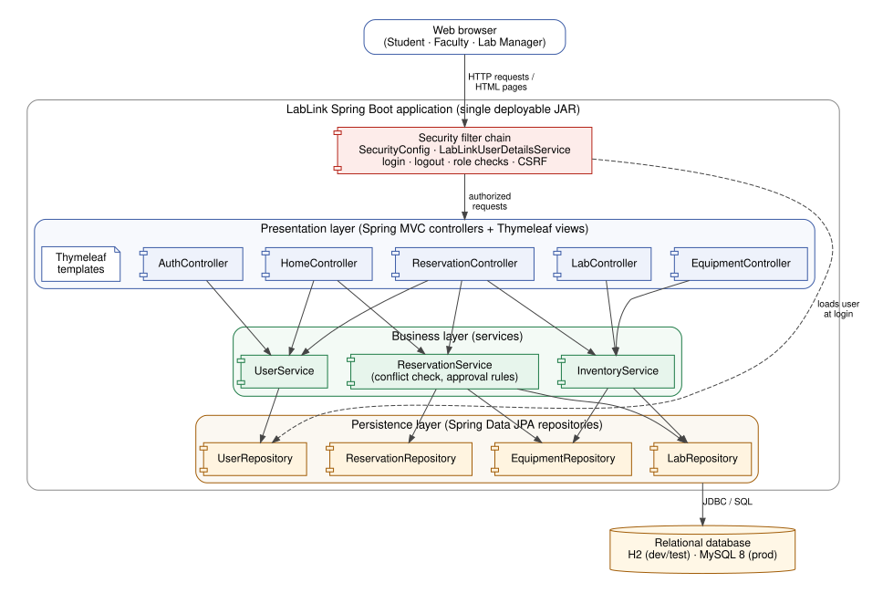

# LabLink Architecture Document

CS450 Software Engineering, Milestone 2 — Design & Architecture
Team: Weston Mattingly, Isaiah Bain, Dawson Brown, PJ

## 1. System overview

LabLink is a web application that lets students and faculty reserve lab rooms and equipment, and lets lab managers maintain the inventory and approve reservation requests. Users interact through a browser; all pages are rendered on the server and data is stored in a relational database.

**Actors**

| Actor | Can do |
|---|---|
| Student | Register, log in, browse labs and equipment, request reservations (need approval), view and cancel own reservations |
| Faculty | Everything a student can; reservations are approved automatically |
| Lab Manager | Everything above, plus create/edit/delete labs and equipment and approve or reject pending requests |

**Core business rules**

1. A reservation is for exactly one lab **or** one piece of equipment.
2. A reservation must start in the future and end after it starts.
3. A lab or piece of equipment cannot be double-booked: a new request is refused if it overlaps any PENDING or APPROVED reservation for the same resource.
4. Inactive labs and equipment that is in MAINTENANCE or RETIRED cannot be reserved.
5. Only the person who made a reservation can cancel it; only a lab manager can approve or reject it.

## 2. Architectural pattern: Layered architecture with MVC

### Selection

LabLink is a **single deployable application (a "modular monolith") organized into four layers**, with the web layer following the **Model–View–Controller (MVC)** pattern:

| Layer | Responsibility | LabLink packages |
|---|---|---|
| Presentation (View + Controller) | Receive HTTP requests, validate form input, choose a page to render | `web`, `web.form`, `templates/` |
| Business (Service) | Enforce the business rules above; coordinate transactions | `service` |
| Persistence (Repository) | Read and write entities; no business logic | `repository` |
| Domain (Model) | Entities that map to database tables | `model` |
| Cross-cutting | Authentication and authorization applied to every request | `security`, `config` |

Each layer may only call the layer directly below it: controllers call services, services call repositories, repositories talk to the database. Controllers never touch repositories for reservations, and templates never contain business logic.

### Justification

- **Fits the problem size.** LabLink has four entities and three roles. A layered monolith gives clear structure without the overhead of distributed services.
- **Fits the team.** Every team member is new to building applications. Layers give each person an obvious place to put code and map directly onto the team roles: authentication (`security`, `AuthController`), reservations (`ReservationService`), front end (`templates/`), and database/inventory (`repository`, `InventoryService`, `schema.sql`).
- **Fits the framework.** Spring Boot is built around this pattern (`@Controller`, `@Service`, `@Repository`), so we follow the framework instead of fighting it.
- **Testability.** Business rules live in one class (`ReservationService`) and can be tested against a real in-memory database without a browser.
- **One deployment.** A single JAR is easy to run locally and deploy for the final demo.

### Alternatives considered

| Alternative | Why not chosen |
|---|---|
| Microservices (separate auth, inventory, reservation services) | Network calls, multiple deployments and distributed data are far more work than the course timeline allows and add no value at this scale. |
| REST API + single-page JavaScript front end (React) | Requires two codebases and two skill sets; server-rendered Thymeleaf lets the whole team work in Java. A REST endpoint can still be added later for the API/advanced-feature requirement. |
| Unstructured "controllers do everything" | Fast at first, but business rules end up duplicated across pages and are hard to test. |

See ADR-0001 for the recorded decision.

## 3. Component diagram

Source: [`diagrams/component.dot`](diagrams/component.dot) (Graphviz). Every controller also renders a Thymeleaf template from `src/main/resources/templates`.

**Which component calls which**

| Controller | Services it uses |
|---|---|
| AuthController | UserService |
| HomeController | UserService, ReservationService |
| LabController, EquipmentController | InventoryService |
| ReservationController | ReservationService, InventoryService, UserService |

| Service | Repositories it uses |
|---|---|
| UserService | UserRepository (also used by LabLinkUserDetailsService at login) |
| InventoryService | LabRepository, EquipmentRepository |
| ReservationService | ReservationRepository, LabRepository, EquipmentRepository |

**How a request flows:** the browser sends a request → the security filter chain checks that the user is logged in and has the right role → a controller validates the form and calls a service → the service applies the business rules and uses repositories to read/write data inside a transaction → the controller picks a Thymeleaf template, which renders HTML back to the browser.

## 4. Technology stack

| Concern | Technology | Version | Why |
|---|---|---|---|
| Language | Java | 17 (LTS) | Taught in our courses; every team member already knows it |
| Application framework | Spring Boot | 3.5 | Industry standard; auto-configuration removes most setup work |
| Web / MVC | Spring MVC | (via Boot) | Controllers, form binding, validation |
| Views | Thymeleaf + Spring Security extras | (via Boot) | Server-rendered HTML in plain Java; show/hide by role |
| Security | Spring Security, BCrypt | (via Boot) | Form login, sessions, role-based access, CSRF protection, password hashing |
| Persistence | Spring Data JPA / Hibernate | (via Boot) | Repositories generate queries from method names |
| Validation | Jakarta Bean Validation | (via Boot) | `@NotBlank`, `@Email`, etc. on forms |
| Database (dev/test) | H2, in memory, MySQL mode | 2.x | Zero install; fresh data on every run |
| Database (production) | MySQL | 8.x | Free, widely hosted, supports CHECK constraints |
| Schema management | Hand-written DDL (`db/schema.sql`) | — | The DDL in the design document is exactly what runs (ADR-0003) |
| Build | Maven | 3.9 | Standard for Spring; dependency management |
| Testing | JUnit 5, Spring Boot Test, MockMvc, AssertJ | (via Boot) | Service tests against H2; full HTTP tests through security |
| CI | GitHub Actions | — | Builds and runs all tests on every push and pull request |
| Version control | Git + GitHub, feature-branch workflow | — | Reviewed pull requests into `main` |
| Hosting (final demo) | Cloud host running the JAR + managed MySQL | TBD in Milestone 3 | — |

## 5. Security design

- Passwords are hashed with BCrypt; plain-text passwords are never stored or logged.
- Self-registration always creates a **STUDENT** account. Faculty and lab manager accounts are created by an administrator (seeded in development), so users cannot grant themselves privileges.
- URL rules in `SecurityConfig` restrict inventory changes and request review to `ROLE_LAB_MANAGER`. The service layer re-checks the role for approve/reject and ownership for cancel, so a rule cannot be bypassed by calling a URL directly.
- All state-changing actions are HTTP POST requests protected by Spring Security's CSRF token, which Thymeleaf adds to every form automatically.
- Database credentials for production come from environment variables, not from the repository.

## 6. Prototype scope (Milestone 2)

The prototype in the repository demonstrates every layer end to end:

- Registration, login and logout with three roles
- CRUD for labs and equipment (lab manager)
- Reservation requests with double-booking prevention, faculty auto-approval, manager approve/reject, and owner cancellation
- DDL-driven schema on H2 with demo data
- 18 automated tests (business rules and HTTP/security) run by GitHub Actions

Planned for later milestones: production MySQL deployment, reservation calendar view, email notifications or a public availability API (advanced feature / API integration requirement), and UI polish.
