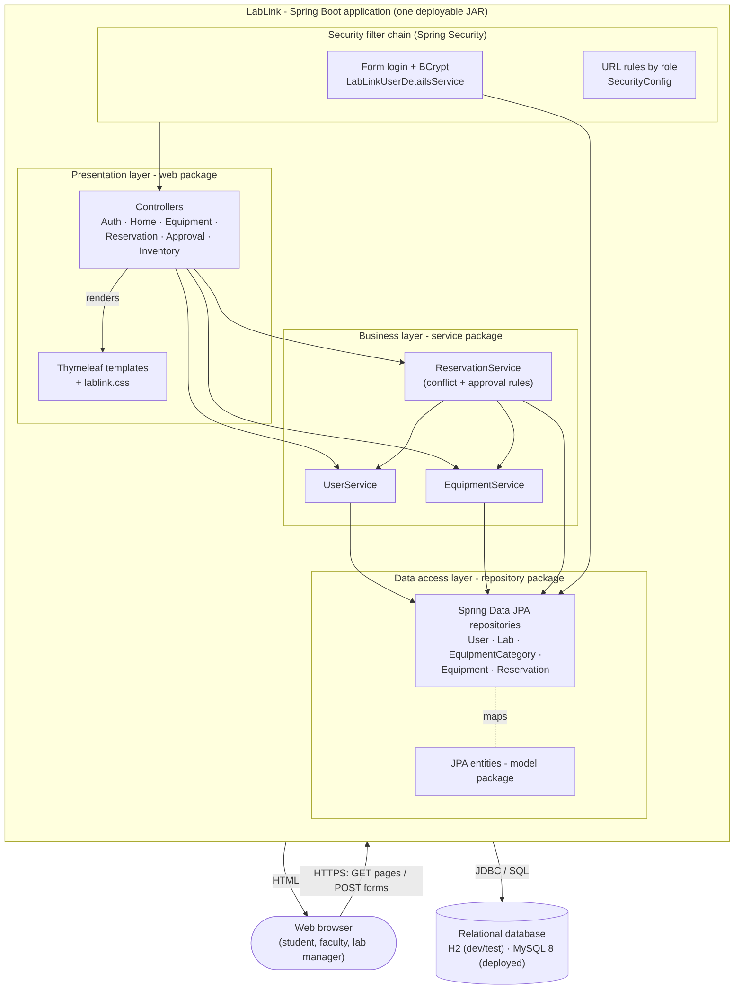

# LabLink — Architecture Document

**Project:** LabLink — Lab & Equipment Reservation System
**Course:** CS450 Software Engineering, Campbellsville University
**Team:** Weston Mattingly · Isaiah Bain · Dawson Brown · PJ
**Milestone:** 2 — Design & Architecture · **Version:** 1.0 · October 2026

---

## 1. Purpose and scope

LabLink replaces paper sign-up sheets for campus lab rooms and equipment. Students and
faculty browse an equipment catalog, request a specific item or a whole lab for a time
window, and track their requests. Lab managers approve or reject requests and keep the
inventory current.

This document records **how the system is structured and why**. It covers the chosen
architectural pattern, the major components and how they talk to each other, and the
technology stack. Individual decisions are recorded in more detail as Architecture
Decision Records in [`adr/`](adr/).

### Requirements that drive the architecture

| # | Requirement (course + team) | Architectural consequence |
|---|---|---|
| R1 | Web front end | Server-rendered HTML pages (ADR-0002) |
| R2 | Persistent relational database | JPA repositories over MySQL; H2 in development (ADR-0003) |
| R3 | Authentication with role-based access control | Spring Security filter chain in front of every request (ADR-0004) |
| R4 | Full CRUD on at least two entities | Reservations (create / read / cancel / review) and Equipment (create / read / update / retire) |
| R5 | Advanced feature | Double-booking prevention + approval workflow (ADR-0005) |
| R6 | Four-person team, one semester, mostly new to app development | Simple, conventional structure that each person can own a slice of (ADR-0001) |
| R7 | Graded Git history and CI | One repository, feature branches, GitHub Actions build on every PR |

---

## 2. Architectural pattern: Layered (N-tier) monolith with MVC

### 2.1 What we chose

LabLink is a **single Spring Boot application** organized into **four layers**. Each layer
has one job and may only call the layer directly beneath it:

| Layer | Java package | Responsibility | Examples |
|---|---|---|---|
| **Presentation** | `web`, `web.dto` | Receive HTTP requests, validate form input, choose which page to show | `ReservationController`, `ReservationForm`, Thymeleaf templates |
| **Business (service)** | `service` | All business rules and transactions | `ReservationService` (conflict check, approval rules) |
| **Data access** | `repository` | Read and write the database | `ReservationRepository.existsEquipmentOverlap(...)` |
| **Domain model** | `model` | The core concepts and their state changes | `Reservation`, `Equipment`, `User` |

Cross-cutting concerns sit beside the layers: **security** (`config.SecurityConfig`)
runs before any controller, and **error handling** (`web.GlobalExceptionHandler`)
turns exceptions into friendly pages.

Inside the presentation layer we use **Model-View-Controller (MVC)**, which Spring MVC
provides: the *controller* handles the request, puts data into a *model*, and returns
the name of a Thymeleaf *view* that renders it as HTML.

> **In plain terms:** a request travels *down* the layers (browser → controller →
> service → repository → database) and the answer travels back *up*. A controller never
> writes SQL, and a template never decides whether a booking is allowed — those jobs
> belong to the repository and the service respectively.

### 2.2 Why this pattern

1. **It fits the size of the problem.** LabLink has five tables, three roles and one
   main workflow. A layered monolith handles this comfortably; nothing about the load
   (a few hundred users on one campus) calls for distributing the system.
2. **It matches what Spring Boot already gives us.** `@Controller`, `@Service` and
   `@Repository` map one-to-one onto the layers, so the framework's documentation,
   tutorials and error messages all line up with our structure.
3. **It splits cleanly across the team.** Each teammate owns a vertical slice (auth,
   reservations, inventory/database, UI) but all slices follow the same layering, so
   code reviews are predictable and merge conflicts are rare.
4. **Business rules are testable in one place.** Because every rule lives in the service
   layer, `ReservationServiceTest` can verify double-booking, time-window and permission
   rules without starting a browser.
5. **One thing to build, run and deploy.** `mvn spring-boot:run` starts everything; the
   final demo deploys a single JAR plus a MySQL database.

### 2.3 Alternatives considered

| Alternative | Why we did not choose it |
|---|---|
| **Microservices** (separate auth, inventory, reservation services) | Needs service-to-service calls, multiple deployments, distributed transactions and much more infrastructure. The overhead would consume the semester with no benefit at our scale. |
| **Single-page app (React/Angular) + REST API** | Two codebases and two build tools, plus token-based auth and CORS. Most of the team has only Java experience; the extra JavaScript stack adds risk to every milestone. (See ADR-0002 — the service layer is reusable if we add a REST API later.) |
| **Hexagonal / ports-and-adapters** | Sound idea, but its extra interfaces and adapter classes are more abstraction than a five-table app needs. Our layering already keeps business rules independent of the web layer. |
| **"Everything in the controller"** (no service layer) | Fastest at first, but rules get duplicated across controllers and become impossible to unit test. |

---

## 3. Component diagram

*Source: [`diagrams/component.mmd`](diagrams/component.mmd) (Mermaid — also renders directly on GitHub).*

### 3.1 Component responsibilities

| Component | Responsibility | Owner |
|---|---|---|
| **Security filter chain** (`SecurityConfig`, `LabLinkUserDetailsService`) | Form login, BCrypt password checks, session management, CSRF protection, role-based URL rules (`/manager/**` → `LAB_MANAGER`) | Weston |
| **AuthController / UserService** | Registration with validation and duplicate-email check; looking up the signed-in user | Weston |
| **ReservationController / ApprovalController / ReservationService** | Requesting, listing, cancelling and reviewing reservations; enforces every reservation rule | Isaiah |
| **EquipmentController / InventoryController / EquipmentService** | Catalog search and filtering; lab manager add/edit of equipment; lab list | PJ |
| **Repositories + entities** | JPA mapping of the five tables; custom overlap queries | PJ |
| **Thymeleaf templates + CSS** (`templates/`, `static/css/`) | All pages, shared navigation fragment, form error display, responsive layout | Dawson |
| **HomeController** | Landing page and role-aware dashboard | Dawson |
| **Database** (H2 / MySQL) | Durable storage; CHECK and FOREIGN KEY constraints as a last line of defense | PJ |

### 3.2 Key interactions

* **Request a reservation** — `ReservationController` validates the form, then calls
  `ReservationService.create`, which loads the item through `EquipmentService`, checks
  its status, asks `ReservationRepository` for overlapping bookings and saves a
  `PENDING` reservation. See [sequence diagram](uml.md#31-request-an-equipment-reservation).
* **Approve a reservation** — the security chain rejects non-managers before the
  controller runs; `ReservationService.review` re-checks the role and that the request
  is still pending. See [sequence diagram](uml.md#32-lab-manager-approves-a-request).
* **Sign in** — handled entirely by Spring Security using our `UserDetailsService`.
  See [sequence diagram](uml.md#33-sign-in).

### 3.3 Request flow and URL map

| URL | Method | Who | Controller → Service |
|---|---|---|---|
| `/`, `/login`, `/register` | GET/POST | Anyone | `AuthController`, `HomeController` |
| `/dashboard` | GET | Signed in | `HomeController` → `ReservationService` |
| `/equipment`, `/equipment/{id}`, `/labs` | GET | Signed in | `EquipmentController` → `EquipmentService` |
| `/reservations`, `/reservations/new` | GET/POST | Signed in | `ReservationController` → `ReservationService` |
| `/reservations/{id}/cancel` | POST | Owner | `ReservationController` → `ReservationService` |
| `/manager/reservations[/{id}/approve\|reject]` | GET/POST | Lab manager | `ApprovalController` → `ReservationService` |
| `/manager/equipment/new`, `/manager/equipment/{id}[/edit]` | GET/POST | Lab manager | `InventoryController` → `EquipmentService` |

---

## 4. Technology stack

| Concern | Technology | Version | Why |
|---|---|---|---|
| Language | Java | 17 (LTS) | The language every teammate knows; LTS release supported by Spring Boot 3 |
| Application framework | Spring Boot | 3.5.x | Auto-configuration, embedded Tomcat, one-command startup |
| Web / MVC | Spring MVC | (Boot-managed) | Controllers, form binding, validation |
| Views | Thymeleaf + `thymeleaf-extras-springsecurity6` | 3.1 | Server-rendered HTML in plain Java tooling; role-aware menus (ADR-0002) |
| Security | Spring Security | 6.x | Form login, BCrypt, CSRF, role-based authorization (ADR-0004) |
| Persistence | Spring Data JPA / Hibernate | 6.x | Repositories generated from interfaces; entity mapping |
| Validation | Jakarta Bean Validation (Hibernate Validator) | 3.x | `@NotBlank`, `@Email`, `@Future` on form objects |
| Database (deployed) | MySQL | 8.0.16+ | Widely hosted, free tier available, enforces CHECK constraints (ADR-0003) |
| Database (dev/test) | H2 in MySQL mode | 2.x | Zero install; same `schema.sql` runs on both |
| Build | Maven | 3.9 | Standard for Spring; IntelliJ imports it directly |
| Testing | JUnit 5, Spring Boot Test, MockMvc, Spring Security Test, AssertJ | (Boot-managed) | Service rules and security rules tested on every build |
| CI | GitHub Actions | — | `mvn verify` on every push and pull request to `main` |
| Version control | Git + GitHub | — | Feature branches, reviewed pull requests (see README) |
| Diagrams | Mermaid, Graphviz | — | Text-based diagrams that live in Git next to the code |

---

## 5. Quality attributes and how the architecture addresses them

| Attribute | Approach |
|---|---|
| **Security** | Every URL passes through Spring Security; passwords stored only as BCrypt hashes; CSRF tokens on all forms; manager endpoints protected by both URL rules and a role check in the service (defense in depth); DB credentials supplied by environment variables, never committed. |
| **Data integrity** | Business rules in `ReservationService`, backed by database constraints (FKs, UNIQUE, CHECK for time order, status values and the one-target rule). |
| **Maintainability** | Strict layering; one class per responsibility; constructor injection; descriptive names; ADRs explain non-obvious choices. |
| **Testability** | Service rules tested against an in-memory database; security rules tested over HTTP with MockMvc; CI blocks merging a red build. |
| **Usability** | Consistent navigation fragment, inline form errors, status badges, flash messages after every action, mobile-friendly CSS. |
| **Performance** | Indexes on reservation `(target, start_time, end_time)` make the conflict check an index lookup; the catalog uses one `JOIN FETCH` query instead of one query per row. Expected load is small (one campus). |
| **Deployability** | One self-contained JAR; `mysql` Spring profile switches the database with environment variables only. |

---

## 6. Known limitations and future work

* **Concurrent double booking.** Two requests submitted in the same instant could both
  pass the overlap check. Acceptable for a prototype; the fix (planned for Milestone 3)
  is a pessimistic lock on the equipment row inside the transaction.
* **Lab vs. equipment overlap.** Booking a whole lab does not yet block individual
  items inside it (or vice versa).
* **Faculty self-registration.** Users can choose "Faculty" when registering; a real
  deployment would verify this or let an administrator assign it.
* **Notifications.** Email on approval/rejection is a candidate "API integration"
  feature for Milestone 3.
* **H2 web console** was intentionally left out (it conflicts with Spring Security's
  URL matching); use IntelliJ's database tool or `spring.jpa.show-sql=true` instead.

---

## 7. Related documents

* [UML models](uml.md) — use case, class, sequence and activity diagrams
* [Database design](database-design.md) — ER diagram, 3NF analysis, DDL
* [Architecture Decision Records](adr/)
* [Project plan](project-plan.md)
