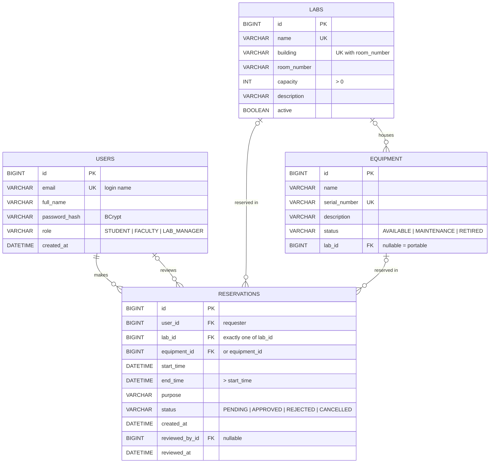

# LabLink Database Design

## 1. ER diagram



**Relationships**

| Relationship | Cardinality | Notes |
|---|---|---|
| User makes Reservation | 1 to 0..* | Every reservation has exactly one requester |
| User reviews Reservation | 0..1 to 0..* | Set when a lab manager approves/rejects |
| Lab houses Equipment | 0..1 to 0..* | Equipment with no lab is portable |
| Lab / Equipment reserved in Reservation | 0..1 to 0..* | A reservation targets exactly one lab **or** one equipment item (CHECK constraint) |

## 2. Normalized schema (3NF)

### Relations

- **users**(<u>id</u>, email, full_name, password_hash, role, created_at)
- **labs**(<u>id</u>, name, building, room_number, capacity, description, active)
- **equipment**(<u>id</u>, name, serial_number, description, status, *lab_id* → labs)
- **reservations**(<u>id</u>, *user_id* → users, *lab_id* → labs, *equipment_id* → equipment, start_time, end_time, purpose, status, created_at, *reviewed_by_id* → users, reviewed_at)

Candidate keys: users.email; labs.name; labs.(building, room_number); equipment.serial_number.

### Functional dependencies

| Relation | Dependencies |
|---|---|
| users | id → email, full_name, password_hash, role, created_at; email → id (candidate key) |
| labs | id → all attributes; name → id; (building, room_number) → id |
| equipment | id → name, serial_number, description, status, lab_id; serial_number → id |
| reservations | id → all attributes |

### Normal form check

**First Normal Form (1NF):** every column holds one atomic value; there are no repeating groups or lists (e.g. a lab's equipment is not stored as a comma-separated column — it is a separate table with a foreign key). Every table has a primary key. ✔

**Second Normal Form (2NF):** all primary keys are single-column surrogate keys (`id`), so no attribute can depend on only part of a key. ✔

**Third Normal Form (3NF):** no non-key attribute depends on another non-key attribute. Decisions that keep it that way:

- `reservations` stores only `user_id`, never the requester's name or email. Storing `user_name` there would create the transitive dependency `id → user_id → user_name` and would go stale if the user changed their name.
- `reservations` stores `lab_id` / `equipment_id`, not the lab's building or room; those depend on the lab, not the reservation.
- `equipment` stores `lab_id`, not the lab's name or building.
- The only determinants on the left of a dependency are candidate keys (`id`, `email`, `name`, `(building, room_number)`, `serial_number`), so the schema also satisfies **Boyce–Codd Normal Form**. ✔

**Example of what we avoided (unnormalized):**

| reservation_id | student_name | student_email | lab_name | building | room | start | end |
|---|---|---|---|---|---|---|---|
| 1 | Ana Ruiz | ana@… | Robotics Lab | Science | 118 | 10/20 9:00 | 10/20 11:00 |
| 2 | Ana Ruiz | ana@… | Robotics Lab | Science | 118 | 10/21 9:00 | 10/21 10:00 |

Here `student_name` depends on `student_email` and `building`/`room` depend on `lab_name` (transitive dependencies), so changing Ana's name or moving the lab means updating many rows (update anomaly), and a lab with no reservations can't be recorded at all (insertion anomaly). Splitting into `users`, `labs` and `reservations` removes these anomalies.

### Design notes

- **Enumerated values** (role, statuses) are stored as text with CHECK constraints rather than lookup tables. The value sets are fixed in code and small; text values keep rows readable. This does not violate 3NF (the status is a fact about the row, not determined by another non-key column).
- **One reservations table with two nullable FKs** instead of separate `lab_reservations` and `equipment_reservations` tables keeps "my reservations" and the approval queue to one simple query. The CHECK constraint guarantees exactly one target.
- **Indexes:** MySQL InnoDB and H2 automatically index foreign-key columns, which serves the double-booking lookup (`lab_id`, `equipment_id`) and "my reservations" (`user_id`). Unique constraints create indexes on email, lab name/location and serial number.

## 3. DDL script

The application runs this exact script at startup: [`src/main/resources/db/schema.sql`](../src/main/resources/db/schema.sql). It is compatible with MySQL 8 and H2 (MySQL mode).

```sql
CREATE TABLE IF NOT EXISTS users (
    id            BIGINT       NOT NULL AUTO_INCREMENT,
    email         VARCHAR(255) NOT NULL,
    full_name     VARCHAR(100) NOT NULL,
    password_hash VARCHAR(100) NOT NULL,
    role          VARCHAR(20)  NOT NULL,
    created_at    DATETIME     NOT NULL,
    CONSTRAINT pk_users PRIMARY KEY (id),
    CONSTRAINT uq_users_email UNIQUE (email),
    CONSTRAINT chk_users_role CHECK (role IN ('STUDENT', 'FACULTY', 'LAB_MANAGER'))
);

CREATE TABLE IF NOT EXISTS labs (
    id          BIGINT       NOT NULL AUTO_INCREMENT,
    name        VARCHAR(100) NOT NULL,
    building    VARCHAR(100) NOT NULL,
    room_number VARCHAR(20)  NOT NULL,
    capacity    INT          NOT NULL,
    description VARCHAR(500),
    active      BOOLEAN      NOT NULL DEFAULT TRUE,
    CONSTRAINT pk_labs PRIMARY KEY (id),
    CONSTRAINT uq_labs_name UNIQUE (name),
    CONSTRAINT uq_labs_location UNIQUE (building, room_number),
    CONSTRAINT chk_labs_capacity CHECK (capacity > 0)
);

CREATE TABLE IF NOT EXISTS equipment (
    id            BIGINT       NOT NULL AUTO_INCREMENT,
    name          VARCHAR(100) NOT NULL,
    serial_number VARCHAR(50)  NOT NULL,
    description   VARCHAR(500),
    status        VARCHAR(20)  NOT NULL,
    lab_id        BIGINT,
    CONSTRAINT pk_equipment PRIMARY KEY (id),
    CONSTRAINT uq_equipment_serial UNIQUE (serial_number),
    CONSTRAINT fk_equipment_lab FOREIGN KEY (lab_id) REFERENCES labs (id),
    CONSTRAINT chk_equipment_status CHECK (status IN ('AVAILABLE', 'MAINTENANCE', 'RETIRED'))
);

CREATE TABLE IF NOT EXISTS reservations (
    id             BIGINT       NOT NULL AUTO_INCREMENT,
    user_id        BIGINT       NOT NULL,
    lab_id         BIGINT,
    equipment_id   BIGINT,
    start_time     DATETIME     NOT NULL,
    end_time       DATETIME     NOT NULL,
    purpose        VARCHAR(255) NOT NULL,
    status         VARCHAR(20)  NOT NULL,
    created_at     DATETIME     NOT NULL,
    reviewed_by_id BIGINT,
    reviewed_at    DATETIME,
    CONSTRAINT pk_reservations PRIMARY KEY (id),
    CONSTRAINT fk_reservations_user FOREIGN KEY (user_id) REFERENCES users (id),
    CONSTRAINT fk_reservations_lab FOREIGN KEY (lab_id) REFERENCES labs (id),
    CONSTRAINT fk_reservations_equipment FOREIGN KEY (equipment_id) REFERENCES equipment (id),
    CONSTRAINT fk_reservations_reviewer FOREIGN KEY (reviewed_by_id) REFERENCES users (id),
    CONSTRAINT chk_reservations_times CHECK (end_time > start_time),
    CONSTRAINT chk_reservations_status CHECK (status IN ('PENDING', 'APPROVED', 'REJECTED', 'CANCELLED')),
    CONSTRAINT chk_reservations_target CHECK (
        (lab_id IS NOT NULL AND equipment_id IS NULL) OR
        (lab_id IS NULL AND equipment_id IS NOT NULL))
);
```

### Sample queries the application issues

```sql
-- Double-booking check for a lab (ADR-0004)
SELECT COUNT(*) > 0
FROM reservations
WHERE lab_id = ?
  AND status IN ('PENDING', 'APPROVED')
  AND start_time < ?   -- requested end
  AND end_time   > ?;  -- requested start

-- Approval queue
SELECT r.*, u.full_name
FROM reservations r JOIN users u ON u.id = r.user_id
WHERE r.status = 'PENDING'
ORDER BY r.start_time;
```
