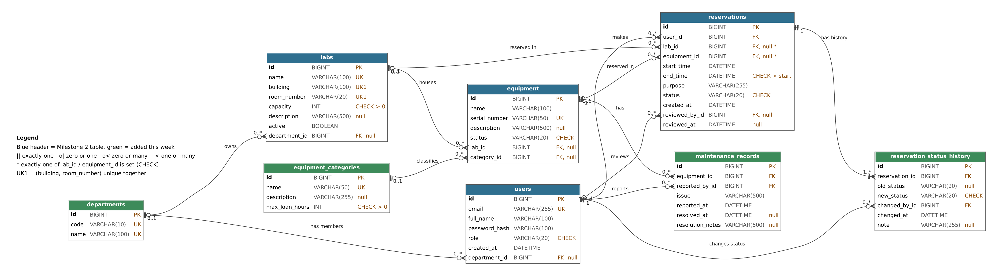

# LabLink Database Design

Week 11 deliverable: ER diagram, normalization analysis, DDL, ORM model, migrations and seed data.
Earlier version (Milestone 2, four tables) is in the Git history of this file.

| Piece | Where it lives |
|---|---|
| ER diagram | [`docs/diagrams/er-diagram.svg`](diagrams/er-diagram.svg) (source: [`er-diagram.dot`](diagrams/er-diagram.dot)) |
| DDL / migrations | [`src/main/resources/db/migration/`](../src/main/resources/db/migration) (`V1__` … `V4__`) |
| ORM model classes | [`src/main/java/edu/campbellsville/lablink/model/`](../src/main/java/edu/campbellsville/lablink/model) |
| Repositories | [`src/main/java/edu/campbellsville/lablink/repository/`](../src/main/java/edu/campbellsville/lablink/repository) |
| Seed data | [`src/main/resources/db/seed/R__seed_test_data.sql`](../src/main/resources/db/seed/R__seed_test_data.sql) |
| Tests | [`DatabaseMigrationIntegrationTest`](../src/test/java/edu/campbellsville/lablink/repository/DatabaseMigrationIntegrationTest.java) |
| Decision record | [ADR-0005: Flyway migrations](adr/0005-flyway-migrations-and-sql-seed-data.md) |

## 1. ER diagram



Eight entities. Blue tables existed in Milestone 2; green tables were added this week.

| # | Relationship | Cardinality | Implemented by |
|---|---|---|---|
| 1 | Department **has members** User | 0..1 to 0..* | `users.department_id` (nullable: self-registered students may not pick one) |
| 2 | Department **owns** Lab | 0..1 to 0..* | `labs.department_id` |
| 3 | Lab **houses** Equipment | 0..1 to 0..* | `equipment.lab_id` (null = portable) |
| 4 | EquipmentCategory **classifies** Equipment | 0..1 to 0..* | `equipment.category_id` |
| 5 | User **makes** Reservation | 1 to 0..* | `reservations.user_id` (NOT NULL) |
| 6 | User **reviews** Reservation | 0..1 to 0..* | `reservations.reviewed_by_id` |
| 7 | Lab **reserved in** Reservation | 0..1 to 0..* | `reservations.lab_id` |
| 8 | Equipment **reserved in** Reservation | 0..1 to 0..* | `reservations.equipment_id`; CHECK: exactly one of 7 / 8 |
| 9 | Reservation **has history** ReservationStatusChange | 1 to 1..* | `reservation_status_history.reservation_id`; the "at least one" is guaranteed by `ReservationService`, which writes a row when the reservation is created |
| 10 | User **changes status** ReservationStatusChange | 1 to 0..* | `reservation_status_history.changed_by_id` |
| 11 | Equipment **has** MaintenanceRecord | 1 to 0..* | `maintenance_records.equipment_id` |
| 12 | User **reports** MaintenanceRecord | 1 to 0..* | `maintenance_records.reported_by_id` |

## 2. Normalization to 3NF

### Relations (PK underlined in the PDF; FK → table)

- **departments**(id, code, name)
- **users**(id, email, full_name, password_hash, role, created_at, department_id → departments)
- **labs**(id, name, building, room_number, capacity, description, active, department_id → departments)
- **equipment_categories**(id, name, description, max_loan_hours)
- **equipment**(id, name, serial_number, description, status, lab_id → labs, category_id → equipment_categories)
- **reservations**(id, user_id → users, lab_id → labs, equipment_id → equipment, start_time, end_time, purpose, status, created_at, reviewed_by_id → users, reviewed_at)
- **reservation_status_history**(id, reservation_id → reservations, old_status, new_status, changed_by_id → users, changed_at, note)
- **maintenance_records**(id, equipment_id → equipment, reported_by_id → users, issue, reported_at, resolved_at, resolution_notes)

### Functional dependencies

| Relation | Dependencies (determinant → dependents) | Candidate keys |
|---|---|---|
| departments | id → code, name; code → id; name → id | id, code, name |
| users | id → all others; email → id | id, email |
| labs | id → all others; name → id; (building, room_number) → id | id, name, (building, room_number) |
| equipment_categories | id → name, description, max_loan_hours; name → id | id, name |
| equipment | id → all others; serial_number → id | id, serial_number |
| reservations | id → all others | id |
| reservation_status_history | id → all others | id |
| maintenance_records | id → all others | id |

### Normal form check

**1NF.** Every column holds a single atomic value and every table has a primary key. There are no lists in a column: a lab's equipment, a reservation's history and an item's repair log are separate tables linked by foreign keys, not comma-separated text. ✔

**2NF.** Every primary key is a single surrogate column (`id`), so no attribute can depend on only *part* of a key. ✔

**3NF.** No non-key column depends on another non-key column. Each determinant in the table above is a candidate key, so the schema is also in **BCNF**. ✔

### Normalization steps taken this week

The Milestone 2 schema was already in 3NF. The new requirements (departments, loan limits, repair log, audit trail) could have been added as extra columns; each one would have introduced a transitive dependency, so each became its own table instead.

| If we had stored… | Dependency it would create | What we did instead |
|---|---|---|
| `users.department_name`, `labs.department_name` | department_code → department_name (non-key → non-key), repeated in every user and lab row | `departments` table; users and labs hold `department_id` |
| `equipment.category_name`, `equipment.max_loan_hours` | category_name → max_loan_hours: changing the laptop limit would mean updating every laptop row (update anomaly) | `equipment_categories`; the limit is stored once per category |
| `equipment.last_issue`, `equipment.last_repaired_at` | repeating group (an item has many repairs over time); only the latest could be kept | `maintenance_records`, one row per issue |
| `reservations.approved_by_name` | reviewed_by_id → reviewer name | only `reviewed_by_id` is stored; the name comes from `users` |

Example of the anomalies avoided (unnormalized equipment table):

| serial | item | category | max_loan_hours | lab | building |
|---|---|---|---|---|---|
| LAP-0001 | Loaner Laptop 1 | Laptop | 72 | Computer Science Lab | Science Building |
| LAP-0002 | Loaner Laptop 2 | Laptop | 72 | Computer Science Lab | Science Building |

`max_loan_hours` depends on `category` and `building` depends on `lab` (both transitive), so changing the laptop limit or moving the lab means editing many rows (update anomaly), a new category can't be recorded until an item exists (insertion anomaly), and deleting the last laptop loses the laptop limit (deletion anomaly).

### Intentional denormalization

Two places deliberately store a value that could be derived from `reservation_status_history`:

1. **`reservations.status`** — the current status is always the `new_status` of the reservation's latest history row, so strictly it is derived data.
   *Why we keep it:* the double-booking check runs on every new or rescheduled reservation and filters on `status IN ('PENDING','APPROVED')`; the approval queue filters on `status = 'PENDING'`. Deriving status would turn each of those into a "latest row per reservation" subquery over the history table. Keeping the column makes these queries simple and indexable (`idx_reservations_status_start`).
   *How we keep it consistent:* the only code that changes status is `ReservationService.changeStatus()` / `saveNew()`, which updates the column and inserts the history row in the same transaction.

2. **`reservations.reviewed_by_id`, `reviewed_at`** — duplicate the `changed_by_id` / `changed_at` of the APPROVED or REJECTED history row.
   *Why we keep them:* the "Manage reservations" page shows who reviewed each request; reading two columns avoids a join + filter on history for every row. They also existed in Milestone 2, so pages and tests already use them.
   *Consistency:* written in the same `review()` call that writes the history row.

Other design decisions that are **not** denormalization: enumerated values (role, statuses) are VARCHAR + CHECK rather than lookup tables because the sets are fixed in code; and `reservations` uses two nullable FKs with a CHECK instead of two separate reservation tables so "my reservations" and the approval queue stay single-table queries.

## 3. DDL

The DDL is split into migration scripts (section 5). Constraints used:

- **PRIMARY KEY** on every table (`BIGINT AUTO_INCREMENT` surrogate keys)
- **FOREIGN KEY** for all 12 relationships in the ER diagram (one FK column per relationship)
- **UNIQUE**: `users.email`, `labs.name`, `labs(building, room_number)`, `equipment.serial_number`, `departments.code`, `departments.name`, `equipment_categories.name`
- **CHECK**: role/status value lists, `capacity > 0`, `max_loan_hours > 0`, `end_time > start_time`, exactly one reservation target, `resolved_at >= reported_at`, `old_status <> new_status`
- **NOT NULL** on every required column
- **Indexes** (V4), each matched to a query:

| Index | Query it serves |
|---|---|
| `idx_reservations_lab_time (lab_id, start_time, end_time)` | double-booking check for a lab |
| `idx_reservations_equipment_time (equipment_id, start_time, end_time)` | double-booking check for equipment |
| `idx_reservations_status_start (status, start_time)` | approval queue: pending, soonest first |
| `idx_reservations_user_start (user_id, start_time)` | "My reservations" |
| `idx_equipment_name (name)` | equipment list sorted by name |
| `idx_history_reservation_time (reservation_id, changed_at)` | a reservation's audit trail |
| `idx_maintenance_equipment_open (equipment_id, resolved_at)` | open tickets for an item |

## 4. ORM (Spring Data JPA / Hibernate)

Each table has an `@Entity` class and a Spring Data repository interface. Hibernate runs with `spring.jpa.hibernate.ddl-auto=validate`: it never creates tables, but the app refuses to start if an entity doesn't match the tables Flyway built, so the model and the DDL can't drift apart.

| Table | Entity | Relationships mapped | Repository |
|---|---|---|---|
| departments | `Department` | — | `DepartmentRepository` |
| users | `User` | `@ManyToOne department` | `UserRepository` |
| labs | `Lab` | `@ManyToOne department` | `LabRepository` |
| equipment_categories | `EquipmentCategory` | — | `EquipmentCategoryRepository` |
| equipment | `Equipment` | `@ManyToOne lab`, `@ManyToOne category` | `EquipmentRepository` |
| reservations | `Reservation` | `@ManyToOne user, lab, equipment, reviewedBy`; `@OneToMany(mappedBy) history` | `ReservationRepository` |
| reservation_status_history | `ReservationStatusChange` | `@ManyToOne(LAZY) reservation, changedBy` | `ReservationStatusChangeRepository` |
| maintenance_records | `MaintenanceRecord` | `@ManyToOne(LAZY) equipment, reportedBy` | `MaintenanceRecordRepository` |

Enum columns use `@Enumerated(EnumType.STRING)` plus `@JdbcTypeCode(SqlTypes.VARCHAR)` so Hibernate expects the VARCHAR + CHECK column we wrote, not a MySQL `ENUM` column.

New behavior using the new tables: `ReservationService` writes a `reservation_status_history` row on every submit/approve/reject/cancel, and rejects equipment reservations longer than the item's category `max_loan_hours`. The lab form has a department dropdown and the equipment form a category dropdown.

## 5. Migrations (Flyway)

Flyway runs at application startup and applies each versioned script once, in order, recording it in the `flyway_schema_history` table.

| Script | What it does |
|---|---|
| `V1__create_core_tables.sql` | users, labs, equipment, reservations (the Milestone 2 schema) |
| `V2__add_departments_and_equipment_categories.sql` | two lookup tables; `ALTER TABLE` adds `department_id` / `category_id` FKs to users, labs, equipment |
| `V3__add_maintenance_records_and_status_history.sql` | the two history tables |
| `V4__add_query_indexes.sql` | composite indexes |
| `db/seed/R__seed_test_data.sql` | repeatable seed script (section 6) |

**Set up the schema from scratch**

```bash
# Development: H2 in memory - schema + seed data are built on every start
mvn spring-boot:run

# Production: empty MySQL database, schema only
DB_URL=jdbc:mysql://localhost:3306/lablink DB_USERNAME=lablink DB_PASSWORD=... \
  mvn spring-boot:run -Dspring-boot.run.profiles=mysql

# Same, plus the demo data
mvn spring-boot:run -Dspring-boot.run.profiles=mysql,seed
```

Rules: never edit a migration that has run on a shared database — add `V5__...` instead. A MySQL database built from the old `schema.sql` is handled by `baseline-on-migrate` at version 1 (Flyway treats V1 as already applied and continues from V2).

## 6. Seed data

`R__seed_test_data.sql` is a Flyway *repeatable* migration: it runs after the versioned ones and again whenever the file changes. It deletes all rows first, so re-running it always produces the same data, and it looks up foreign keys by natural key (email, lab name, serial number) instead of hard-coded ids.

| Table | Rows | Notes |
|---|---|---|
| users | 25 | 3 lab managers, 6 faculty, 16 students (includes the three demo logins) |
| labs | 20 | 2 inactive |
| equipment | 30 | 3 in MAINTENANCE, 2 RETIRED, 1 uncategorized |
| reservations | 40 | 10 pending, 22 approved, 3 rejected, 5 cancelled; past and future; no overlapping active bookings |
| reservation_status_history | 62 | consistent with each reservation's status and reviewer |
| maintenance_records | 21 | 3 open (matching the MAINTENANCE items), 18 resolved |
| departments | 8 | lookup table |
| equipment_categories | 10 | lookup table |

The six major tables have at least 20 rows each; the two lookup tables hold one row per real department / equipment type, since padding them to 20 would mean inventing fake departments. `DatabaseMigrationIntegrationTest` checks the 20-row minimum, that all four migrations applied, and that seeded foreign keys resolve through the ORM.

Demo logins: `manager@lablink.edu / manager123`, `faculty@lablink.edu / faculty123`, `student@lablink.edu / student123`; all other seeded accounts use `password123`.

## 7. Sample queries

```sql
-- Double-booking check for a lab (ADR-0004); uses idx_reservations_lab_time
SELECT COUNT(*) > 0 FROM reservations
WHERE lab_id = ? AND status IN ('PENDING', 'APPROVED')
  AND start_time < ?   -- requested end
  AND end_time   > ?;  -- requested start

-- A reservation's audit trail
SELECT h.changed_at, h.old_status, h.new_status, u.full_name, h.note
FROM reservation_status_history h JOIN users u ON u.id = h.changed_by_id
WHERE h.reservation_id = ? ORDER BY h.changed_at, h.id;

-- Equipment currently out for repair, with the open ticket
SELECT e.name, c.name AS category, m.issue, m.reported_at
FROM equipment e
JOIN maintenance_records m ON m.equipment_id = e.id AND m.resolved_at IS NULL
LEFT JOIN equipment_categories c ON c.id = e.category_id;
```
