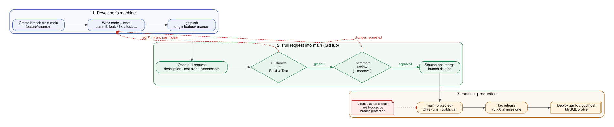
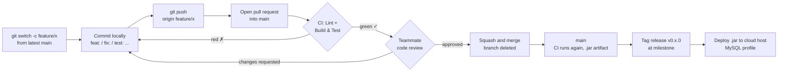

# Git Workflow & CI/CD Pipeline

How LabLink code moves from a developer's laptop to `main` and on to production.
Everyone on the team follows these rules; branch protection on GitHub enforces the important ones.

## 1. Branching strategy

We use **GitHub Flow**: one long-lived branch, `main`, plus short-lived branches for each piece of work.

- **`main` is always working code.** Every commit on `main` has passed CI and been reviewed.
  Nobody pushes to `main` directly; changes only arrive through pull requests.
- **One branch per task.** Branch off the latest `main`, do one feature or fix, open a PR, merge, delete the branch.
  Aim for branches that live a few days, not weeks, so merges stay small.

### Branch naming

`<type>/<short-description>` in lowercase with hyphens:

| Prefix | Use for | Example |
|---|---|---|
| `feature/` | New functionality | `feature/reservation-calendar` |
| `fix/` | Bug fixes | `fix/double-booking-overlap` |
| `test/` | Adding or improving tests only | `test/inventory-service-edge-cases` |
| `docs/` | Documentation only | `docs/git-workflow` |
| `ci/` | Build, pipeline, or tooling changes | `ci/add-checkstyle-lint` |
| `refactor/` | Restructuring with no behavior change | `refactor/extract-time-validation` |

```bash
git switch main
git pull
git switch -c feature/reservation-calendar
```

## 2. Commit message format

We follow [Conventional Commits](https://www.conventionalcommits.org/):

```
<type>: <what this commit does, imperative mood, under ~70 characters>

<optional body: why the change was needed, anything a reviewer should know>
```

Types match the branch prefixes: `feat`, `fix`, `test`, `docs`, `ci`, `refactor`, plus `chore` for housekeeping.

Good:
```
feat: let lab managers approve pending reservations
fix: reject reservations that end before they start
test: cover equipment status changes in InventoryService
```

Avoid: `updates`, `fixed stuff`, `WIP`. A commit message should tell a teammate what changed without opening the diff.

Rules of thumb: one logical change per commit; never commit code that doesn't compile; never commit passwords, keys, or `.env` files.
(Commits before Week 10 predate this convention.)

## 3. Pull request process

1. **Push your branch** and open a PR into `main`. The PR template fills in the sections below.
2. **Write the description:** what changed, why, how you tested it, and any screenshots for UI changes. Link the backlog item.
3. **CI runs automatically.** Two checks appear on the PR:
   - **Lint** – Checkstyle; violations are marked on the exact lines in the *Files changed* tab.
   - **Build & Test** – compiles, runs every unit and integration test, enforces 70% service-layer coverage, and builds the `.jar`.
     Test counts and coverage appear on the *Checks* tab.
4. **Request a review** from at least one teammate (Isaiah Bain is Code Review Lead).
5. **Reviewer** reads the diff, leaves comments (questions, bugs, suggestions), and either *Requests changes* or *Approves*.
   Reviewers aim to respond within 24 hours.
6. **Author** responds to every comment, pushes fixes to the same branch (CI re-runs), and resolves the conversations.
7. **Merge** once the PR meets the merge policy below.

## 4. Merge policy

A PR can be merged into `main` only when **all** of these are true (GitHub enforces the first four):

- ✅ At least **1 approving review** from someone other than the author
- ✅ **Lint** and **Build & Test** checks are green
- ✅ The branch is **up to date with `main`** (click *Update branch* if GitHub asks)
- ✅ All review conversations are **resolved**
- ✅ The description is complete

How we merge:

- **Squash and merge.** All of a PR's commits become one commit on `main`, titled with the PR title in commit-message format
  (e.g. `feat: add reservation calendar view (#5)`). This keeps `main`'s history one-line-per-feature.
- **Delete the branch** after merging (GitHub offers a button; the repository is set to do it automatically).
- If a merge breaks `main`, the fix is a new PR (or a *Revert* PR via GitHub's button), never a direct push.

## 5. Branch protection rules on `main`

Configured in **Settings → Branches → Branch protection rule** for `main`:

| Setting | Value | Why |
|---|---|---|
| Require a pull request before merging | On | No direct pushes; every change is reviewed |
| Required approvals | 1 | A second set of eyes on every change |
| Dismiss stale approvals when new commits are pushed | On | An approval covers the code actually being merged |
| Require conversation resolution before merging | On | Review comments can't be ignored |
| Require status checks to pass | On: `Lint`, `Build & Test` | Broken or unlinted code can't reach `main` |
| Require branches to be up to date before merging | On | CI ran against the latest `main` |
| Do not allow bypassing the above settings | On | Rules apply to the repository owner too |
| Allow force pushes / deletions | Off | `main`'s history can't be rewritten or lost |

## 6. CI/CD pipeline

Defined in [`.github/workflows/ci.yml`](../.github/workflows/ci.yml). It runs on every push to any branch and on every pull request into `main`.

| Job | What it does | Fails when |
|---|---|---|
| **Lint** | `mvn checkstyle:check` against [`config/checkstyle/checkstyle.xml`](../config/checkstyle/checkstyle.xml): unused/star imports, naming conventions, missing braces, empty catch blocks, `equals` without `hashCode`, tabs, lines over 140 chars | Any violation |
| **Build & Test** | `mvn verify`: compile → all unit tests (Mockito) and integration tests (Spring Boot + H2) → package the `.jar` → JaCoCo coverage check. Uploads the coverage report, test results, and `.jar` as downloadable artifacts | Compile error, any failing test, or service-layer line coverage below 70% |

Results are reported on the pull request three ways: the pass/fail check next to each commit, inline annotations on the
changed lines, and a summary table (tests run/failed, lint violations, coverage by package) on the run's summary page.

### Continuous delivery to production

Every push to `main` produces a tested, runnable `lablink-<version>.jar` as a CI artifact, so `main` is always releasable.
At each milestone we tag the `main` commit (`git tag v0.3.0 && git push --tags`) and deploy that tagged build to the cloud host
with the MySQL profile (`SPRING_PROFILES_ACTIVE=mysql`, database credentials from environment variables, never from the repo).
Hosting is planned for Milestone 3 per the [project plan](project-plan.md); until then "production" is the tagged release artifact.

## 7. Workflow diagram




