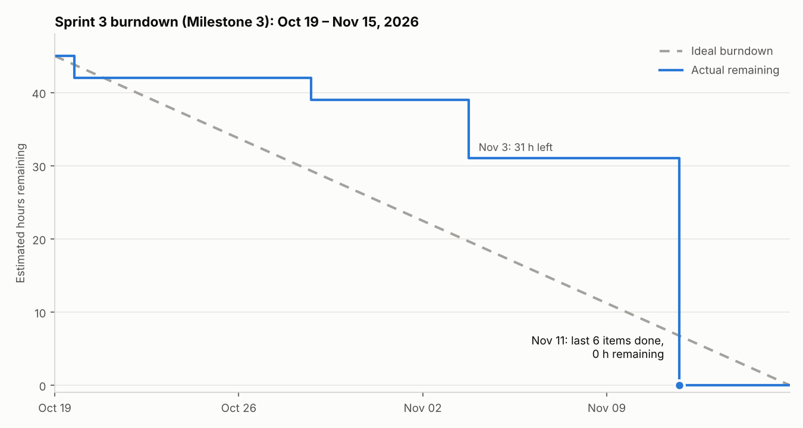

# Sprint 3 Progress Tracking (Milestone 3)

Sprint window: **October 19 – November 15, 2026** (Milestone 3 due Nov 15).
Scope: the 10 backlog items in [project-plan.md §4](project-plan.md#4-milestone-3-work-breakdown), **45 estimated hours**.
Data as of **November 11, 2026**: all 10 items done.

## How the chart is built

- The scope is the sum of the hour estimates in the project plan (45 h).
- A backlog item counts as burned on the date its work was finished, from `git log` and the merged pull requests.
  Partial work is not counted.
- The ideal line burns the 45 h evenly over the 28-day sprint.

## What the chart shows

The first three weeks tracked well behind the ideal line: 31 h were still open on November 3. Six items
(31 h) were then finished on November 11, four days before the deadline. The main cause was uneven
contribution across the team, already listed as the top risk in the project plan. For Milestone 4 we will
assign work as GitHub Issues with due dates mid-sprint, so problems show up earlier.

## Backlog status

| # | Task | Owner (plan) | Estimate | Status | Completed | Evidence |
|---|---|---|---|---|---|---|
| 3.1 | Flyway migrations; MySQL profile | PJ | 4 h | ✅ Done | Nov 3 | PR #7 (Flyway V1–V4, 8-table schema). CI runs on H2 in MySQL mode |
| 3.2 | Reservation calendar/availability view | Isaiah | 6 h | ✅ Done | Nov 11 | PR #11 (`/labs/{id}/availability` week view) |
| 3.3 | Reschedule a pending reservation | Isaiah | 3 h | ✅ Done | Oct 19 | PR #2 (TDD: RED → GREEN → REFACTOR commits) |
| 3.4 | Admin page for accounts and roles | Weston | 4 h | ✅ Done | Nov 11 | PR #10 (`/admin/users`) |
| 3.5 | Password change and account page | Weston | 3 h | ✅ Done | Oct 28 | PR #5 |
| 3.6 | Advanced feature: public REST availability API | Weston + Isaiah | 8 h | ✅ Done | Nov 11 | PR #12, [api.md](api.md) |
| 3.7 | UI redesign | Dawson | 8 h | ✅ Done | Nov 11 | PR #13 (layout, nav, mobile, form feedback) |
| 3.8 | Search/filter labs and equipment | Dawson | 3 h | ✅ Done | Nov 11 | PR #9 |
| 3.9 | Tests for inventory CRUD and new features | PJ | 4 h | ✅ Done | Nov 3 | Mockito unit tests, `DatabaseMigrationIntegrationTest` |
| 3.10 | Update docs/diagrams | All | 2 h | ✅ Done | Nov 11 | PR #8 and this update ([uml.md](uml.md)) |

**Burned: 45 h of 45 h. 10 of 10 items done.**

"Owner (plan)" is who the project plan assigned. Who actually did the work is visible in the commit
history and the pull requests.

## Burndown data

| Date | Item(s) finished | Hours burned | Remaining |
|---|---|---|---|
| Oct 19 | Sprint start | — | 45 |
| Oct 19 | 3.3 | 3 | 42 |
| Oct 28 | 3.5 | 3 | 39 |
| Nov 3 | 3.1, 3.9 | 8 | 31 |
| Nov 11 | 3.2, 3.4, 3.6, 3.7, 3.8, 3.10 | 31 | 0 |

## Unplanned work done in this sprint

These were not in the Sprint 3 backlog, so they are not in the burndown, but they took real effort:

| Work | Date | Where |
|---|---|---|
| JaCoCo coverage reporting and CI test/coverage summaries | Oct 19 | PR #2 |
| Checkstyle lint job in CI | Oct 28 | PR #3 |
| Team Git workflow doc, PR template, `protect-main` ruleset | Oct 28 – Nov 1 | PR #4 |
| Fixes for 10 SonarQube issues | Nov 11 | PR #6 |

## Tests at the end of Sprint 3

154 test methods (`@Nested` classes and parameterized cases can make the CI count higher).

| Kind | Count | Files |
|---|---|---|
| Unit (Mockito or plain Java, no Spring context) | 85 | `ReservationServiceTest`, `InventoryServiceTest`, `InventorySearchTest`, `UserServiceTest`, `UserAdminServiceTest`, `AvailabilityServiceTest`, `AvailabilityApiControllerTest`, `NavigationAdviceTest` |
| Integration (Spring context + H2 + Flyway seed data) | 69 | `ReservationRepositoryIntegrationTest`, `DatabaseMigrationIntegrationTest`, `ReservationServiceIntegrationTest`, `ReservationWebIntegrationTest`, `SecurityAndRegistrationIntegrationTest`, `AccountIntegrationTest`, `SearchFilterIntegrationTest`, `AdminIntegrationTest`, `AvailabilityIntegrationTest`, `AvailabilityApiIntegrationTest`, `NavigationIntegrationTest` |

Coverage: every CI run uploads the JaCoCo HTML report as the `jacoco-coverage-report` artifact and
posts per-package coverage as annotations on the run page.

## Carried over to Milestone 4

No Sprint 3 items. Milestone 4 work is in [project-plan.md §5](project-plan.md#5-milestone-4-outline):
cloud deployment with managed MySQL, an end-to-end test pass, accessibility check and the final demo.
