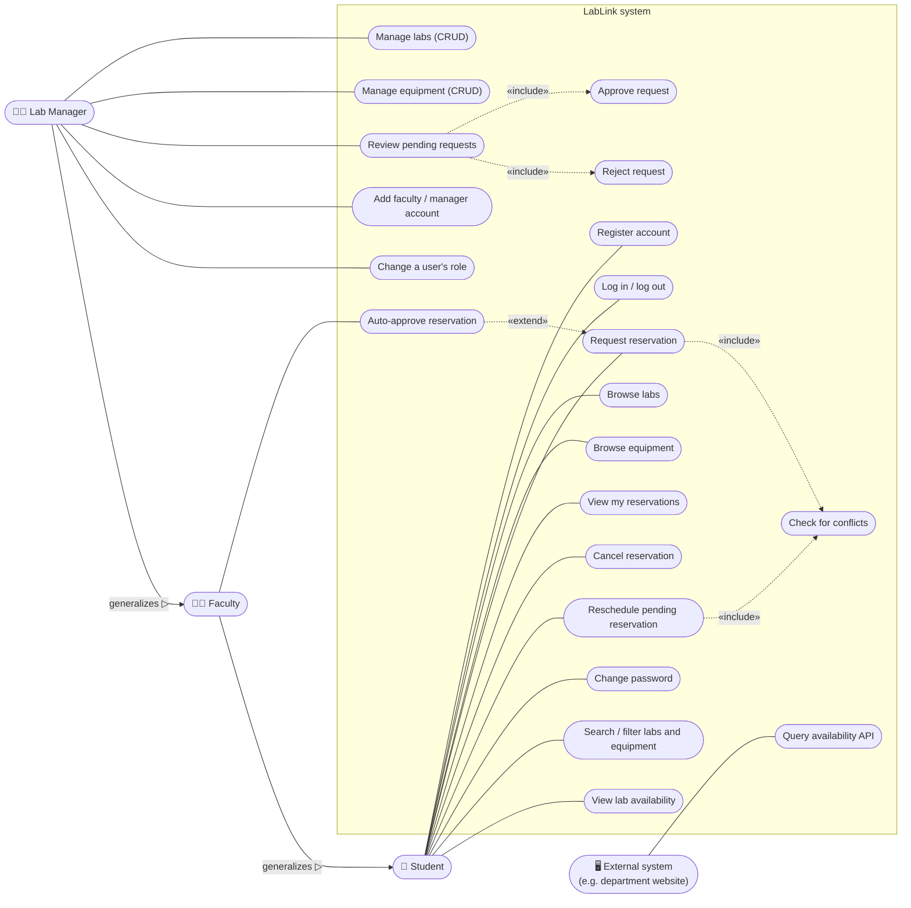
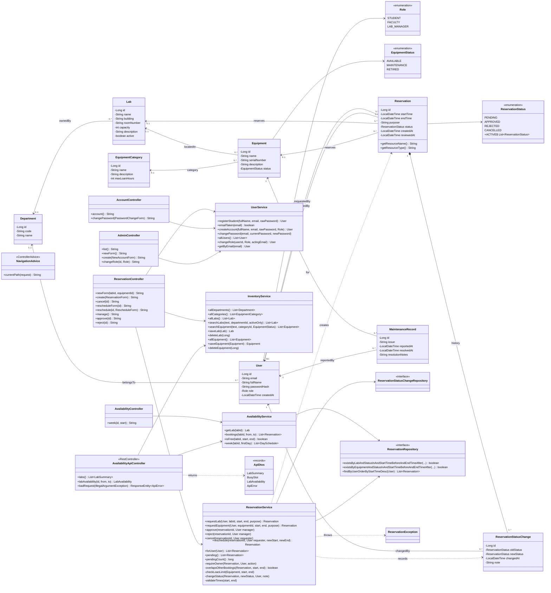
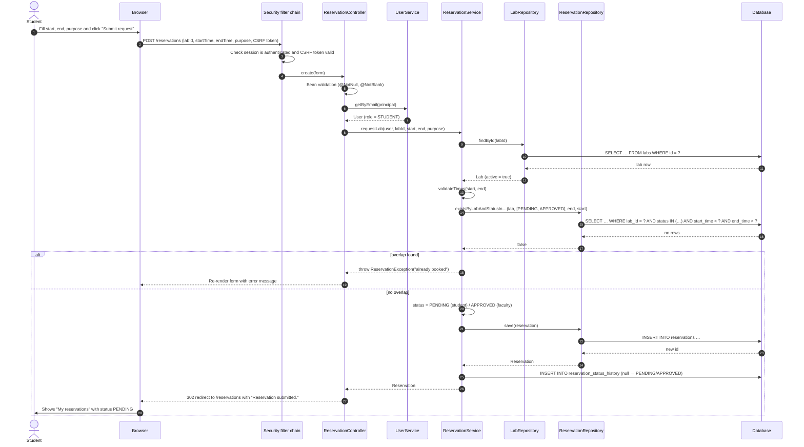
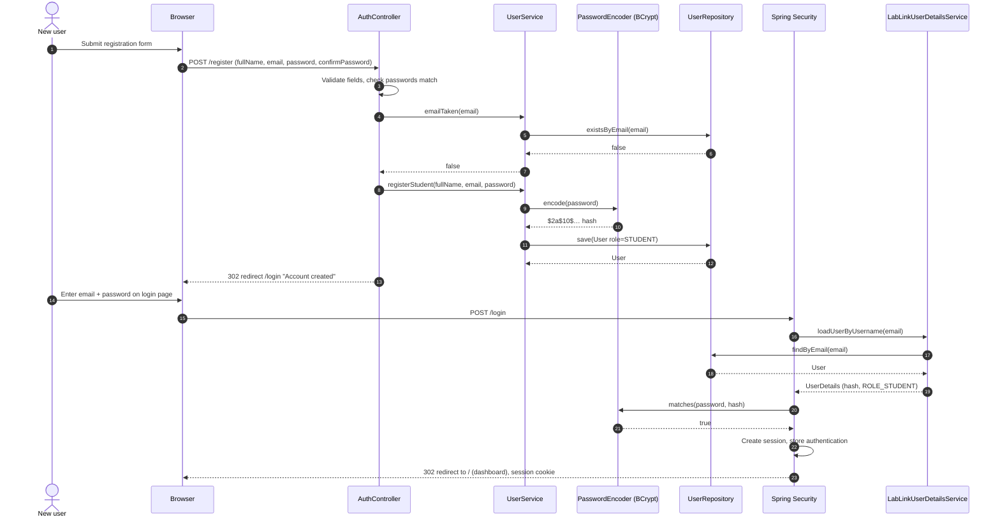
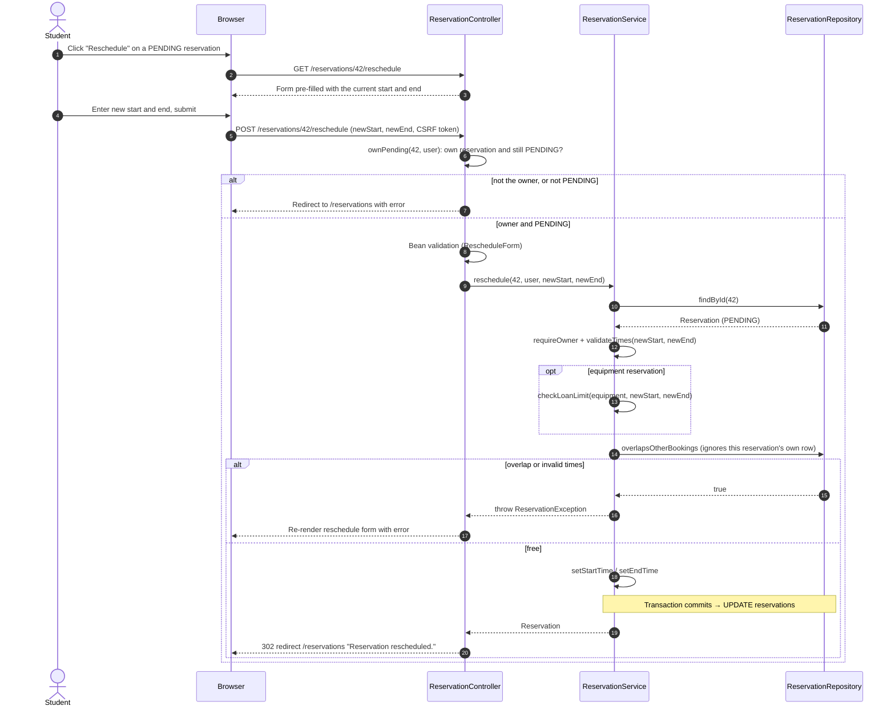
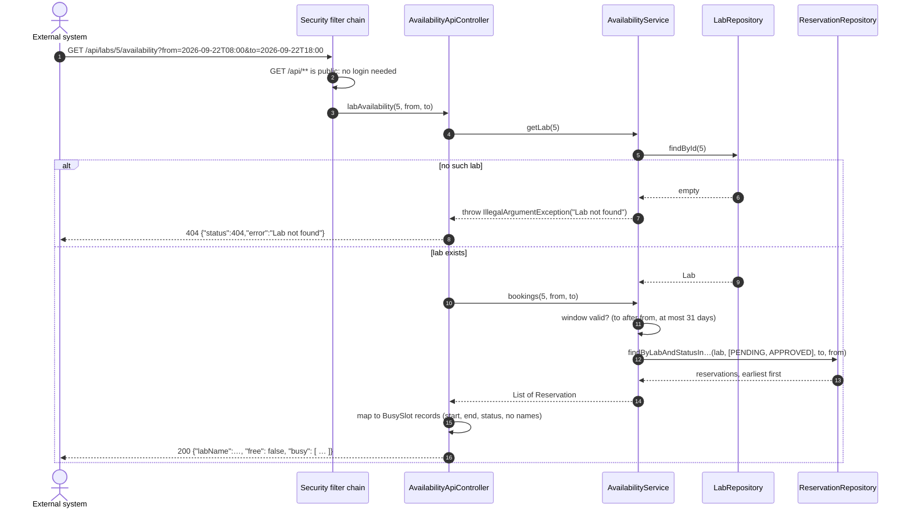
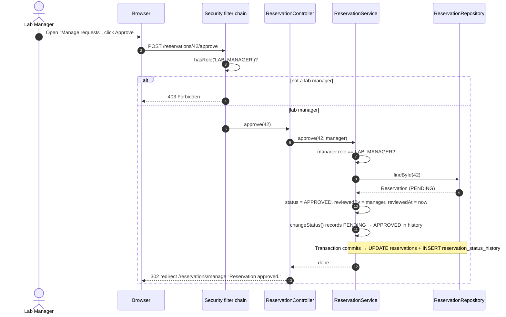
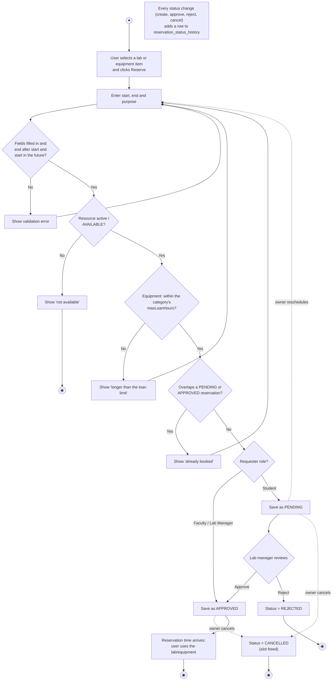

# LabLink UML Models

All diagrams describe the code on `main` at the end of Milestone 3 (Sprint 3 pull requests #2–#13).

**What changed since Milestone 2**

| Change | Where it shows up |
|---|---|
| Reschedule a pending reservation (backlog 3.3) | New use case; `ReservationService.reschedule`; new sequence diagram §5; activity diagram §8 |
| Account page and password change (backlog 3.5) | New use case; `AccountController`, `UserService.changePassword` |
| Database redesign: 4 → 8 tables with Flyway migrations (backlog 3.1) | Class diagram adds `Department`, `EquipmentCategory`, `MaintenanceRecord`, `ReservationStatusChange` |
| Every status change is recorded in `reservation_status_history` | `ReservationService.changeStatus` / `saveNew`; sequence diagrams §3 and §7 |
| Equipment loan limit per category (`maxLoanHours`) | `ReservationService.checkLoanLimit`; activity diagram §8 |
| `DevDataSeeder` removed; demo data now loaded by `R__seed_test_data.sql` | Not a UML element — see ADR-0005 |
| Search and filter labs and equipment (backlog 3.8) | New use case; `InventoryService.searchLabs` / `searchEquipment` |
| Admin page for accounts and roles (backlog 3.4) | New use cases; `AdminController`, `UserService.createAccount` / `changeRole` |
| Lab availability week view (backlog 3.2) | New use case; `AvailabilityService`, `AvailabilityController` |
| Public REST availability API (backlog 3.6, advanced feature) | New *External system* actor; `AvailabilityApiController`, `ApiDtos`; sequence diagram §6 |
| UI refresh (backlog 3.7) | `NavigationAdvice` (highlights the current section in the nav bar) |

## 1. Use case diagram

Actors are on the left; use cases (ovals) sit inside the LabLink system boundary. Faculty and Lab Manager inherit every use case of the actor they generalize.

| Use case | Actor | Summary |
|---|---|---|
| Register account | Student | Create a STUDENT account with name, email and password |
| Log in / log out | All | Authenticate with email and password |
| Browse labs / equipment | All | List rooms and items with location and status |
| Request reservation | All | Pick a resource and time window; the system checks for conflicts |
| Auto-approve | Faculty, Lab Manager | Requests from these roles skip the approval queue |
| View / cancel my reservations | All | See own reservations; cancel ones still pending or approved |
| Reschedule pending reservation | All | Move an own PENDING reservation to a new time; the conflict and loan-limit checks run again |
| Change password | All | On the account page, enter the current password and a new one (confirmed twice) |
| Search / filter | All | Narrow the lab list by text, department and active status; equipment by text, category and status |
| View lab availability | All | A week of a lab's bookings, one card per day, with previous/next week links |
| Add account / change role | Lab Manager | Create faculty and lab-manager accounts; change anyone's role except their own |
| Query availability API | External system | `GET /api/labs` and `GET /api/labs/{id}/availability` return JSON; no login needed |
| Manage labs / equipment | Lab Manager | Create, edit, delete inventory |
| Review / approve / reject | Lab Manager | Decide on students' pending requests |

## 2. Class diagram

Domain entities, the services that hold business rules, and how controllers and repositories connect to them. (Getters/setters omitted.)

## 3. Sequence diagram — Request a lab reservation (with conflict check)

## 4. Sequence diagram — Register and log in

## 5. Sequence diagram — Reschedule a pending reservation (new in Milestone 3)

## 6. Sequence diagram — External system checks lab availability through the REST API (new in Milestone 3)

## 7. Sequence diagram — Lab manager approves a request

## 8. Activity diagram — Reservation life cycle

