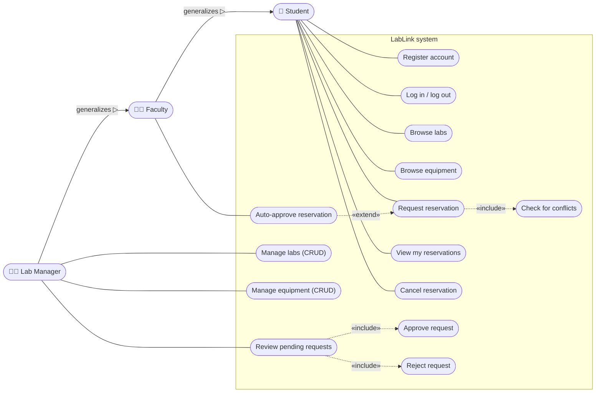
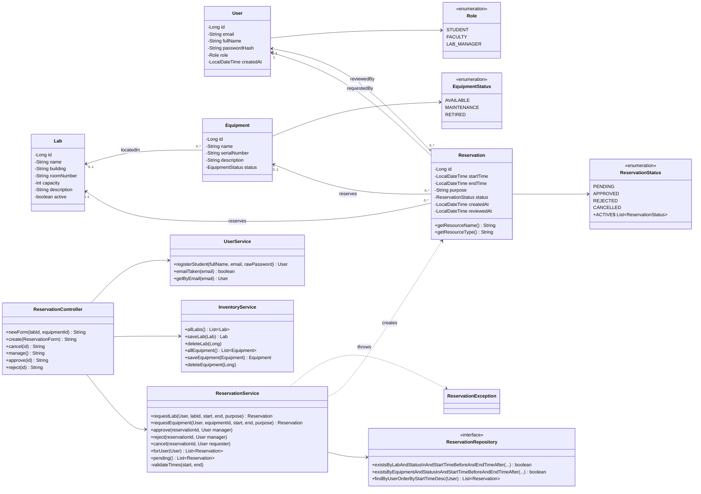
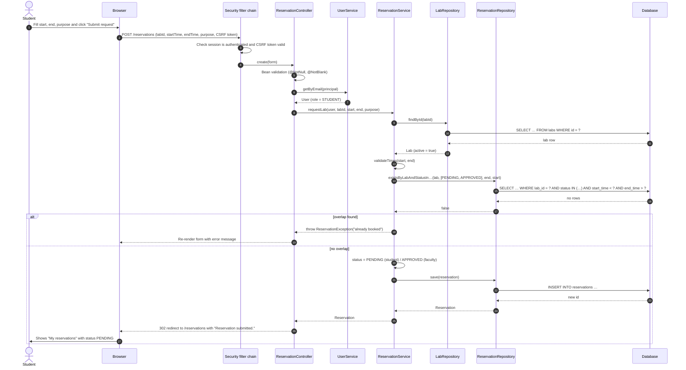
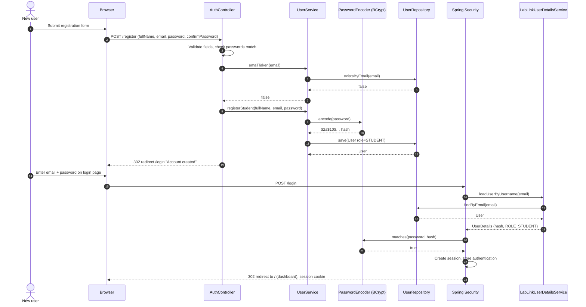
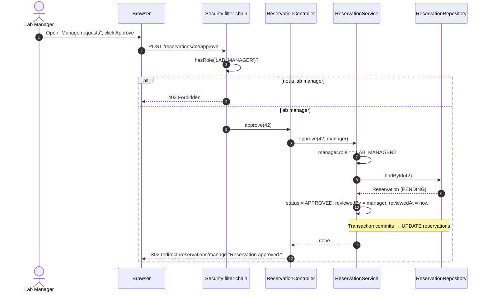
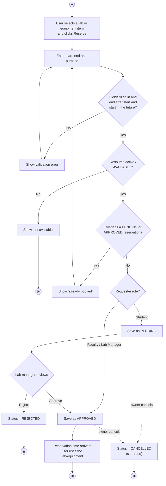

# LabLink UML Models

All diagrams describe the code in the repository as of Milestone 2.

## 1. Use case diagram

Actors are on the left; use cases (ovals) sit inside the LabLink system boundary. Faculty and Lab Manager inherit every use case of the actor they generalize.

| Use case | Actor | Summary |
|---|---|---|
| Register account | Student | Create a STUDENT account with name, email and password |
| Log in / log out | All | Authenticate with email and password |
| Browse labs / equipment | All | List rooms and items with location and status |
| Request reservation | All | Pick a resource and time window; the system checks for conflicts |
| Auto-approve | Faculty, Lab Manager | Requests from these roles skip the approval queue |
| View / cancel my reservations | All | See own reservations; cancel ones still pending or approved |
| Manage labs / equipment | Lab Manager | Create, edit, delete inventory |
| Review / approve / reject | Lab Manager | Decide on students' pending requests |

## 2. Class diagram

Domain entities, the services that hold business rules, and how controllers and repositories connect to them. (Getters/setters omitted.)

## 3. Sequence diagram — Request a lab reservation (with conflict check)

## 4. Sequence diagram — Register and log in

## 5. Sequence diagram — Lab manager approves a request

## 6. Activity diagram — Reservation life cycle

